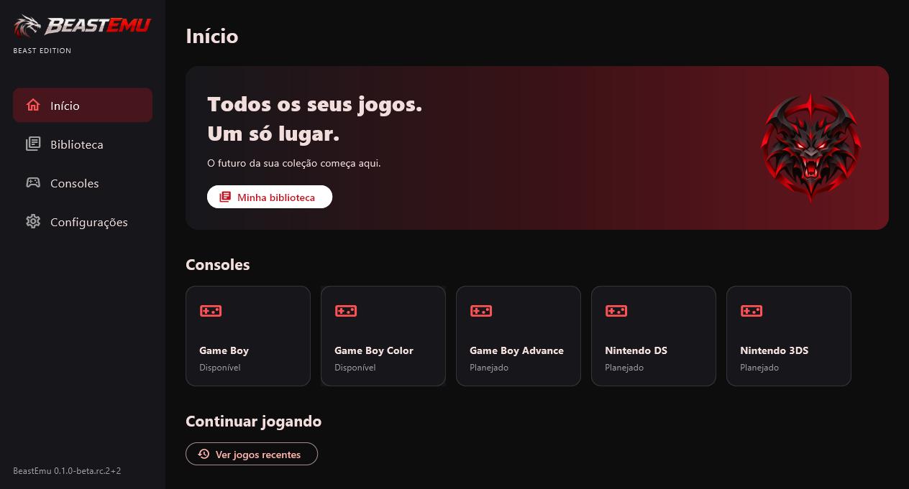

# BeastEmu


Emulador de Game Boy e Game Boy Color para Windows x64, com interface Beast Edition em português e núcleo SameBoy Libretro. Primeira beta para Windows: **v0.1.1-beta.1**, build 3.

O BeastEmu organiza a biblioteca no próprio computador e reproduz áudio estéreo via XAudio2. Cada pessoa importa os cartuchos aos quais tem acesso legítimo. A distribuição não inclui jogos ou ROMs comerciais.



[Janela estreita](design/previews/janela-estreita.png) · [Tela Sobre do aplicativo](design/previews/sobre.png)

## Instalar e jogar

1. Em Windows 10 ou 11 x64, execute o instalador BeastEmu. Ele cria um atalho no menu Iniciar e oferece um atalho na área de trabalho. Para usar o portátil, extraia o ZIP inteiro e abra `beastemu.exe`. Se solicitado, instale o Visual C++ v14 Redistributable x64 da Microsoft. [Guia de instalação e atualização](docs/windows-instalador.md)
2. Em **Biblioteca → Adicionar jogos GB/GBC**, escolha seus arquivos próprios `.gb` ou `.gbc` descompactados. O aplicativo guarda uma cópia privada. Use os filtros GB/GBC, a estrela de favoritos e a lista de recentes para encontrar o jogo. As capas são imagens locais escolhidas por você.
3. Selecione **Jogar**. Por padrão, setas ou WASD movem o direcional, X corresponde a A, Z a B, Enter a Start e Shift a Select. Em **Configurações**, ajuste teclado, gamepad Xbox/XInput, volume, escala e filtragem.
4. Ao terminar, use **Sair** e aguarde o encerramento da sessão para concluir a gravação.

## Atalhos durante o jogo

| Ação | Tecla padrão |
|---|---|
| Salvar ou carregar o slot rápido da ROM | F5 para salvar, F9 para carregar |
| Alternar mudo | M |
| Percorrer 1×, 2×, 3× e 4× | F8 ou botão **Acelerar** |
| Acelerar temporariamente a 4× | Segure Tab e solte para voltar à velocidade selecionada |
| Alternar tela cheia | F11 |

Altere essas teclas em **Configurações → Atalhos do emulador**. A aceleração silencia o áudio e a velocidade alcançada depende do computador. Ao voltar a 1×, o aplicativo retoma o volume e o mudo escolhidos.

## Guardar progresso

Salvar pelo menu do próprio jogo grava os dados de cartucho, incluindo o relógio RTC quando disponível. Use esse recurso para continuar normalmente após reabrir. **Salvar estado** e **Carregar estado** oferecem cinco instantâneos por ROM. A interface confirma a substituição de um slot ocupado. Após restaurar um estado, guarde o progresso dessa sessão nos slots. Reabrir uma sessão normal retoma o save de cartucho protegido. [Pastas de dados e backup](docs/windows-instalador.md#atualizar-e-desinstalar)

## Dois jogadores no mesmo computador

Abra **Biblioteca → Link Cable Local**, selecione as duas ROMs e escolha **Conectar**. J1 fica à esquerda e usa o teclado. Com um gamepad XInput ele pertence a J2. Com dois controles, o primeiro opera J1 e o segundo J2. O áudio vem de J1. O modo experimental conserva saves separados por ROM e posição. Mantenha a mesma posição na sessão seguinte. Save states e aceleração estão disponíveis no modo individual. A comunicação serial tem teste com ROMs sintéticas. A troca real de Pokémon ainda precisa de validação. [Roteiro da demonstração](docs/windows-portatil.md#conferir-o-link-cable-local)

## Compilar no Windows

Use Flutter 3.47.9 (Dart 3.13.7), Visual Studio com a carga **Desenvolvimento para desktop com C++** e Windows SDK. Rode os comandos na raiz do repositório.

```powershell
flutter doctor -v
flutter pub get
flutter analyze
flutter build windows
```

Para executar jogos e os testes de integração, coloque a DLL SameBoy x64 validada em `cores/windows/sameboy_libretro.dll`. Ela pode ser extraída do portátil correspondente. O hash SHA-256 exigido é `491aaf9074ef2f1cf641d87b3b17f44d488e648d111cd48825072d95916d7d7b`. A revisão do núcleo é `90e2899`. Uma recompilação pode gerar outro binário e exige revalidação antes de mudar o hash. [Código do núcleo](https://github.com/libretro/SameBoy/tree/90e2899)

```powershell
dart run tool/package_windows.dart
$env:BEASTEMU_TEST_PACKAGE = (Resolve-Path -LiteralPath (Read-Host 'Pasta gerada pelo empacotador')).Path
flutter test --concurrency=1
```

O portátil inclui os auxiliares compilados. A geração opcional do instalador requer PowerShell 7 e Inno Setup 7 x64. [Comandos do instalador](docs/windows-instalador.md#reproduzir-o-instalador)

## Compatibilidade, créditos e relatos de erro

A distribuição tem como alvo Windows x64 e controles XInput. O portátil usa o perfil da conta para a biblioteca e os saves. Ao trocar de computador, faça backup também dos dados da conta. O instalador está sem assinatura Authenticode e o Windows SmartScreen pode exibir um aviso. Confira a origem e compare o SHA-256 do arquivo com o da distribuição. O proprietário confirmou o ciclo de instalação, atualização, desinstalação e reinstalação no Windows. As notas da beta descrevem as limitações. O roteiro de validação está na [auditoria de publicação](docs/auditoria-publicacao.md). [Notas da beta](docs/release-beta.md) · [Histórico de alterações](CHANGELOG.md)

Ao relatar um problema, informe a versão exibida no BeastEmu, a versão do Windows, se usou o instalador ou o portátil, o modo de jogo e os passos para reproduzir. Descreva o resultado observado e o esperado. Para problemas de áudio ou controle, identifique o dispositivo. Prefira reproduzir com as ROMs sintéticas. Remova caminhos pessoais das mensagens e capturas e mantenha ROMs, saves e configurações privadas fora do relato. [Como contribuir](CONTRIBUTING.md)

## Licença

O código autoral do BeastEmu sobre o qual Beast detém os direitos é distribuído sob a licença MIT. Copyright (c) 2026 Beast. Ao redistribuir cópias ou partes substanciais, inclua o aviso de copyright e o texto da licença. SameBoy, Libretro, Flutter, Dart, fontes, ícones e demais componentes de terceiros seguem suas próprias licenças. A identidade visual pode acompanhar versões oficiais inalteradas com os avisos preservados. [Política da marca](MARCA.md) · [Origem das artes](design/README.md) · [Licença MIT do BeastEmu](LICENSE) · [Créditos e atribuições](docs/terceiros.md)
